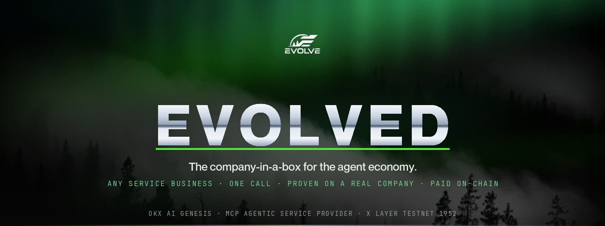
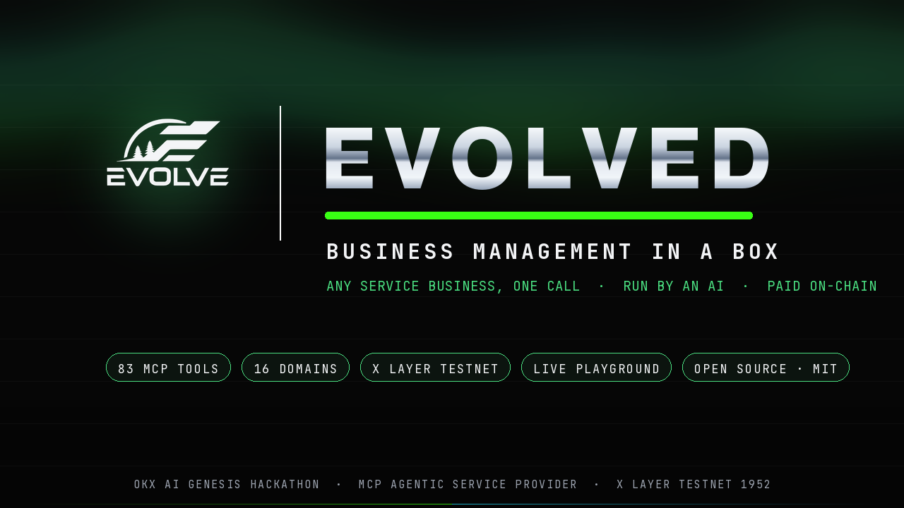
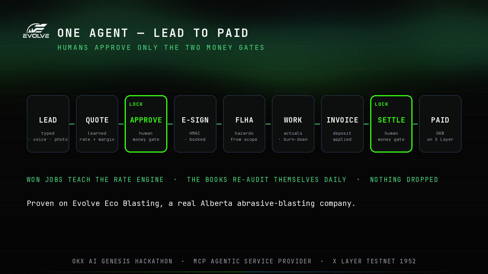
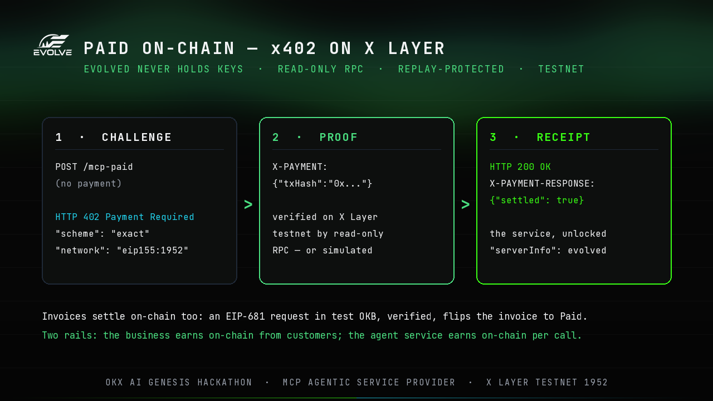
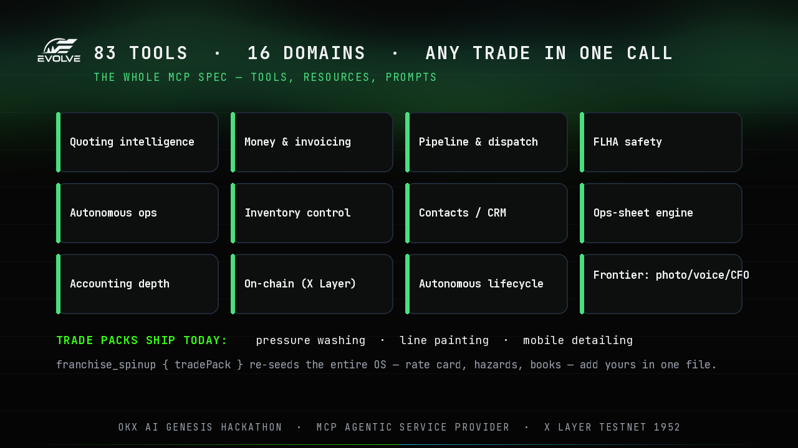
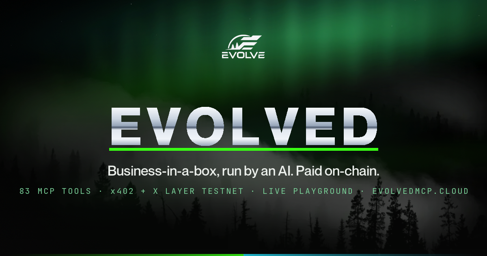

<div align="center">



# evolvedmcp.cloud

### The landing page and zero-install playground for **Evolved** — a company-in-a-box for the agent economy.

A premium product site with a live, in-browser **Judge Mode**: run voice commands, photo-quote a driveway, drive an autonomous business lifecycle through its human money gates, and watch a real x402 `402 → proof → receipt` settlement — all against the live MCP endpoint, no install and no keys.

<br>

### ▶ **[TRY IT LIVE — www.evolvedmcp.cloud](https://www.evolvedmcp.cloud/)**

<br>

[](https://www.evolvedmcp.cloud/)
[](https://kr8tiv.io)
[](https://www.evolvedmcp.cloud/)
[](https://web3.okx.com/xlayer)
[](https://www.okx.ai)
[](LICENSE)

<sub>A **KR8TIV AI** portfolio piece · the front-end for the [kr8tiv-ai/evolved](https://github.com/kr8tiv-ai/evolved) MCP service</sub>

</div>

---

## What this is

**This repository is the website** — the marketing landing page and the interactive browser playground served at [www.evolvedmcp.cloud](https://www.evolvedmcp.cloud/). It is the front-of-house for **Evolved**, an MCP "business-in-a-box" agent (83 tools across 16 domains) built for the **OKX AI Genesis Hackathon** from the live operations system of a real Alberta abrasive-blasting company.

The design brief was simple and unusual for a hackathon: **make it feel like a product launch, not a developer demo — and let a judge understand and *try* the whole thing in about 60 seconds.** So the site leads with a one-click autopilot ("Judge Mode") that narrates the full story on its own, backed by real calls to the live service.

> The agent, the 83 tools, the on-chain rails, and the business logic live in the main repo — **[kr8tiv-ai/evolved](https://github.com/kr8tiv-ai/evolved)**. This repo is the *site*: the page, the branding, the motion, and the demo film.

<div align="center">

|  |  |
|:--:|:--:|
| <br><sub>Cinematic landing — aurora canvas, chrome wordmark, live business ticker</sub> | <br><sub>Judge Mode running the autonomous lifecycle, narrated live</sub> |
| <br><sub>The raw x402 flow — 402 challenge, proof, settlement receipt</sub> | <br><sub>The 83-tool surface, rendered as a product feature grid</sub> |

</div>

## The 90-second film

Every figure in the film was captured live from the endpoint. It ships in this repo at [`demo/evolved-demo.mp4`](demo/evolved-demo.mp4) and streams on the live site.

<div align="center">

[](https://www.evolvedmcp.cloud/demo.mp4)

<sub>▶ Click to play the hosted cut · or open <a href="demo/evolved-demo.mp4">demo/evolved-demo.mp4</a> in this repo.</sub>

</div>

## How it's built

A deliberately **framework-free** front-end: one self-contained page, no bundler, no build step, no client dependencies. The entire site — markup, styles, motion, and the interactive playground logic — is authored as a single HTML document ([`src/playground.ts`](src/playground.ts) exports it as `PLAYGROUND_HTML`; [`index.html`](index.html) in this repo is the rendered snapshot).

| Layer | What it does |
|---|---|
| **The page** | One hand-written HTML document. Vanilla JS only — no React, no framework, no runtime. Fast first paint, nothing to hydrate. |
| **Motion** | An animated aurora painted on a `<canvas>`, layered with film-grain and a vignette, plus scroll-reveal transitions and a looping brand hero video (`media/hero.webm`). All of it yields to `prefers-reduced-motion`. |
| **Judge Mode** | A one-click autopilot that scripts the whole narrative — business snapshot, photo-to-quote, the autonomous lifecycle through both money gates, and on-chain settlement — with a live progress rail and a real business ticker. |
| **Live wiring** | The playground talks to the real service from the browser: `POST /demo/call` runs a whitelisted set of the agent's tools, `GET /health` and `GET /stats` read live status and the revenue scoreboard, and the on-chain panel runs the **raw x402 handshake** directly against `POST /mcp-paid` — `402 Payment Required` → present proof → `X-PAYMENT-RESPONSE` settlement receipt. |
| **On-chain** | The x402 pay-per-call tier and EIP-681 invoice settlement run on **OKX X Layer testnet** (chainId 1952). Simulated by default so anyone can try it with zero funds; every simulated settlement says so. |
| **Hosting** | Deployed on **Hostinger** as a small Node container (Docker), serving the page and its brand media same-origin behind a strict Content-Security-Policy — the browser only ever talks back to its own origin. |
| **Type & brand** | `Archivo` for display, `JetBrains Mono` for code and data readouts, over the Evolve dark palette. Self-hosted `.webp`/`.webm` media; an embedded `og.png` social card. |

Because the page is a single static document, the visual experience in this repo is fully faithful — open `index.html` and the hero, film, cards, and layout render exactly as they do in production. The *interactive* Judge Mode calls the live endpoint, which is why the real thing lives at **[evolvedmcp.cloud](https://www.evolvedmcp.cloud/)**.

## Design philosophy

**Feel like a premium product, not a hackathon submission.** A trades-business operating system is an unglamorous thing to sell; the site's job was to make it feel inevitable and alive.

- **The brand system.** *Boreal Void* `#0a0a0a` grounds every surface. *Aurora Neon* `#4ade80` and *Cyber Lime* `#39ff14` carry the accents, labels, and the signature underline; *Ice* `#22d3ee` marks the on-chain rail; *Alloy Silver* `#f3f4f6` sets the type. A chrome wordmark and refined, tracked headings give it a hardware-launch confidence rather than a dev-tool flatness.
- **Clarity, then motion.** The aurora, grain, and scroll reveals set a mood without ever getting in front of the message. Motion is a garnish on a page that reads perfectly still — and it respects the reader: everything animated degrades cleanly under `prefers-reduced-motion`.
- **Try it in 60 seconds.** The single most important design decision. A judge shouldn't have to read docs, install a client, or hold keys to believe the claim. Judge Mode turns "here's what it does" into "watch it do it, right now, against the live service."
- **Honest by construction.** The playground shows the *real* protocol — the actual 402 envelope, the actual settlement receipt header, the live `/stats` scoreboard ticking. Nothing is faked for the camera; the demo data is synthetic, the machinery is not.
- **Mobile and accessibility care.** Hard viewport-width caps on every structural block (nothing overflows on a phone), semantic landmarks, `aria-label`s and real `alt` text on media and controls, keyboard-reachable actions, and the reduced-motion path throughout.

## Run it locally

No build, no dependencies — it's a static site.

```bash
git clone https://github.com/kr8tiv-io/evolvedmcp-cloud.git
cd evolvedmcp-cloud

# any static server works; e.g.
npx serve .
# then open the printed http://localhost:… URL
```

Opening `index.html` directly works too; a local HTTP server is only needed so the browser will play the bundled `.webm`/`.mp4`. The **interactive** Judge Mode calls the live production endpoint — the full experience is at **[www.evolvedmcp.cloud](https://www.evolvedmcp.cloud/)**.

## What's in here

```text
evolvedmcp-cloud/
├── index.html              the rendered site — the exact page served in production
├── src/
│   └── playground.ts       the authored source of that page (exports PLAYGROUND_HTML)
├── media/                  brand motion + imagery, served same-origin
│   ├── hero.webm           looping cinematic hero
│   ├── hero-poster.webp    poster / reduced-motion still
│   └── *.webp              feature-card imagery (decks, industrial, motors, corner log)
├── demo/
│   └── evolved-demo.mp4    the 90-second film (1080p, on-brand, captioned)
├── assets/                 branding — hero, social card (og.png), logos, gallery, SVGs
├── screenshots/            stills used in this README
├── LICENSE                 MIT
└── README.md
```

## Links

| | |
|---|---|
| **Live site** | [www.evolvedmcp.cloud](https://www.evolvedmcp.cloud/) |
| The Evolved agent (full source) | [github.com/kr8tiv-ai/evolved](https://github.com/kr8tiv-ai/evolved) |
| Health / status | [evolvedmcp.cloud/health](https://www.evolvedmcp.cloud/health) · [/stats](https://www.evolvedmcp.cloud/stats) |
| The studio | [kr8tiv.io](https://kr8tiv.io) |

## Credits

Designed and built by **[Matt Haynes](https://github.com/Matt-Aurora-Ventures)** — founder of **KR8TIV AI** (Edmonton, Alberta) — as the front-of-house for the Evolved MCP service, for the OKX AI Genesis Hackathon. Front-end engineering pairing with **Claude** (Anthropic).

Built from the brand and live operations system of **[Evolve Eco Blasting](https://www.evolveecoblasting.com)**.

<div align="center">
<br>
<sub>MIT licensed · synthetic demo data only · testnet only · no secrets in this repository</sub>
<br><br>
<code>BUILT WITH ♥ BY KR8TIV · EDMONTON, ALBERTA 🇨🇦</code>
</div>
